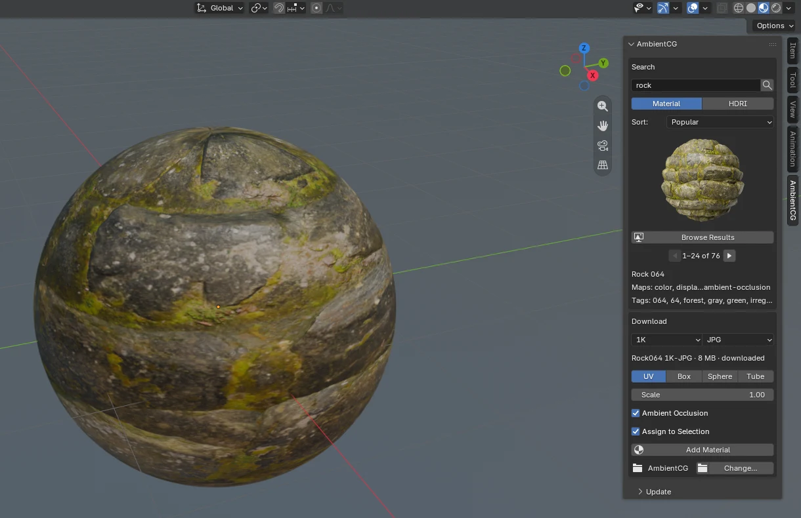
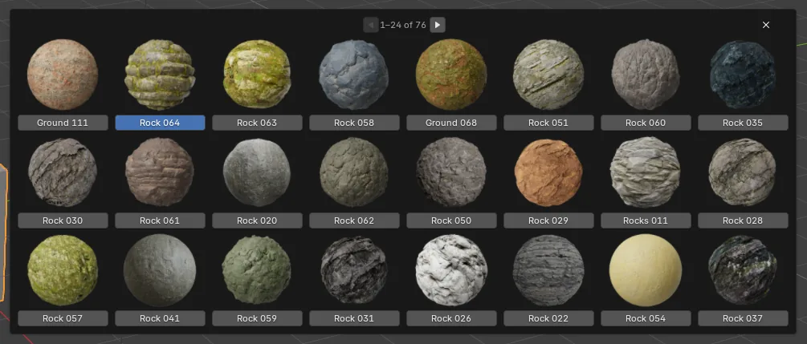

# AmbientCG Browser

A free Blender extension that searches [ambientCG](https://ambientcg.com) from the sidebar and adds its CC0
materials and HDRIs to your file. It lives in **3D Viewport › Sidebar (`N`) › AmbientCG**. Blender 4.2 or newer;
tested on 4.2 LTS, 4.5 LTS and 5.2 LTS.

> **Unofficial.** An independent project, not affiliated with, endorsed by or supported by ambientCG.



- **Search** by keyword, materials or HDRIs, sorted by popularity, date, name or downloads.
- **Browse Results**: a window of thumbnails, 24 a page, with Prev and Next and an X to close it.
- **Add Material**: downloads the maps once in the resolution and format you choose (1K to 16K, JPG or PNG; the
  size shows first), builds the material and puts it on the selected objects, by UV or by Box, Sphere or Tube
  projection.
- **Set World HDRI**: makes an HDRI the scene's world, with strength and rotation sliders.
- **Works offline** for everything you downloaded, and for searches you ran in the last 30 days.
- **Python API** for scripts: the same work, synchronous.



## Install

Install it from its repository so Blender can update it later. The install page has the button to drag onto
Blender and every step: **<https://jsiovn.github.io/ambientcg-browser/>**

By drag and drop:

1. With Blender open, drag the button of the install page onto the Blender window.
2. The first time, Blender says the extension comes from an unknown repository: click **Add Repository…**, tick
   **Check for Updates on Startup**, click **Create**.
3. Drag the button onto Blender again and click **OK**. Allow online access if Blender asks.

Or by repository URL:

1. *Edit › Preferences › Get Extensions › Repositories ›* **+** *› Add Remote Repository*.
2. URL `https://jsiovn.github.io/ambientcg-browser/index.json`, tick **Check for Updates on Startup**.
3. Search **AmbientCG Browser** in Get Extensions and click **Install**.

Do not use *Install from Disk*: Blender never updates that copy. If you did, uninstall it and install again as
above.

## Use

1. In the 3D Viewport press `N` and open the **AmbientCG** tab.
2. Type what you are looking for and press Enter. Switch between **Material** and **HDRI**, change the sort order.
3. **Browse Results** opens the thumbnails; a click on a name picks that result.
4. Choose the resolution and JPG or PNG.
5. **Add Material** puts the material on the selected objects (untick *Assign to Selection* to only create it).
   **Set World HDRI** makes an HDRI the scene's world; the world you had stays in the file.

A material is built from the maps the asset has: color (multiplied by ambient occlusion), roughness, metalness,
normal, opacity, emission, and height as bump displacement. Adding the same asset again reuses its material;
other options rebuild its nodes.

## Cache folder

Downloads, thumbnails and saved searches go to the system temp folder (`ambientcg-browser` inside it) until you
pick your own folder: **Pick Folder…** at the bottom of the panel, or *Preferences › Add-ons › AmbientCG Browser*.

Your .blend links to the image files in that folder, it does not embed them, and the system may clear the temp
folder: pick a permanent folder before real work. If the files of a material ever go missing, add the asset
again: it is downloaded again and the same material is repaired.

## Python API

The functions of the `ambientcg` module do the same work for scripts: synchronous, no context needed. The package
is `bl_ext.<repository>.ambientcg_browser`, so look it up instead of hard-coding the repository:

```python
import importlib
import addon_utils
import bpy

name = next(m.__name__ for m in addon_utils.modules() if m.__name__.endswith(".ambientcg_browser"))
ambientcg = importlib.import_module(name + ".ambientcg")

ambientcg.search("wood", kind="MATERIAL", sort="Popular", limit=24)   # [{"id", "name", "kind", "tags", ...}]
ambientcg.asset("Rock035")                                            # one asset, None when unknown
ambientcg.fetch("Rock035", "2K-JPG")                                  # folder of the maps, downloaded once
mat = ambientcg.create_material("Rock035", "2K-JPG", projection="BOX", blend=0.2, scale=1.0, use_ao=True)
ambientcg.assign(mat, bpy.context.selected_objects)                   # the objects that changed
ambientcg.set_world("DayEnvironmentHDRI114", "4K", strength=1.0, rotation=0.0)
ambientcg.attach("Rock035")                                           # material on the selection, or a world
```

Attributes are `1K-JPG` .. `8K-PNG` for a material and `1K` .. `16K` for an HDRI; leave it out for 2K JPG or the
nearest there is. The functions raise `RuntimeError` when they must go online and online access is off, and
`api.FetchError` when ambientCG fails. The docstring of `ambientcg_browser/ambientcg.py` has the details.

## Update

With **Check for Updates on Startup** ticked for the repository, Blender offers new versions in *Get Extensions*.
Or press **Check for Updates** in the panel's *Update* section or in the add-on preferences: a newer version is
downloaded and installed right away.

## FAQ

**Is this an official ambientCG add-on?** No. It is an independent project that uses ambientCG's public API.

**Do I need an account or an API key?** No.

**What may I do with the assets?** Everything on ambientCG is released under
[CC0](https://docs.ambientcg.com/license/): any use, no attribution required. The license of this add-on
(GPL-3.0-or-later) covers the add-on only.

**Blender says "Online access is off".** Allow it in *Preferences › System › Network*. Assets you already
downloaded work without it.

**My object has no UV map.** Pick **Box**, **Sphere** or **Tube** projection before adding the material.

**Can it sit next to other asset add-ons?** Yes. It only adds its own tab, and marks the materials and worlds it
makes with a custom property so it can find them again.

## Privacy

The add-on talks only to ambientcg.com and its file servers (searches, thumbnails, downloads) and to
`jsiovn.github.io` (the update check, when you ask for it). No telemetry, no account, no API key.

## Credits

All materials and HDRIs come from [ambientCG](https://ambientcg.com), which makes them and gives them away as
CC0. The site runs on donations: if it helps your work, consider supporting it on
[Patreon](https://www.patreon.com/ambientCG) or [Ko-fi](https://ko-fi.com/ambientCG).

## Develop

```powershell
python -I -m unittest discover tests                  # api.py, the tools, the license files: no Blender, no network
powershell -ExecutionPolicy Bypass -File build.ps1    # dist\: the zip, index.json and the landing page

# Inside Blender, headless, with a profile of its own so your preferences are never touched:
$env:BLENDER_USER_RESOURCES = "$env:TEMP\ambientcg-browser-profile"
& blender --background --factory-startup --python-exit-code 1 --python tests\smoke_register.py
& blender --background --factory-startup --python-exit-code 1 --python tests\test_nodes.py
```

To try an install or an update, serve `dist\` (`python -m http.server --directory dist`) and add
`http://127.0.0.1:8000/index.json` as a remote repository. See [CONTRIBUTING.md](CONTRIBUTING.md).

## Release

1. Bump `version` in `ambientcg_browser/blender_manifest.toml`.
2. Add a `## [x.y.z] - YYYY-MM-DD` section to `CHANGELOG.md`.
3. Push to `main`. The **Publish** workflow builds the zip, deploys the repository index and the landing page to
   GitHub Pages and creates release `v<x.y.z>`. A push without a version bump publishes nothing.

A change to the landing page alone (`site/`) ships by running the **Publish** workflow by hand with **redeploy**
ticked: it republishes the released zip with the new page.

One-time owner setup (enables Pages with the Actions source):

```bash
gh api repos/jsiovn/ambientcg-browser/pages -X POST -f build_type=workflow
```

## License

Copyright © 2026 jsiovn.

AmbientCG Browser is free software: you can redistribute it and/or modify it under the terms of the
[GNU General Public License](LICENSE) as published by the Free Software Foundation, either version 3 of the
License, or (at your option) any later version (`GPL-3.0-or-later`).

It is distributed in the hope that it will be useful, but WITHOUT ANY WARRANTY; without even the implied warranty
of MERCHANTABILITY or FITNESS FOR A PARTICULAR PURPOSE. See the GNU General Public License for more details. Its
text is [`LICENSE`](LICENSE), and it is inside the extension zip as well.

The assets you download are ambientCG's, under CC0.
